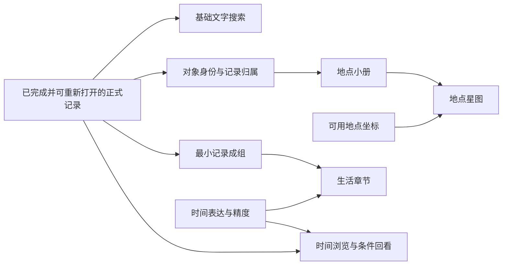

# Folio 整体需求审查

更新日期：2026-10-30。本文维护现行能力的归属、前置与共用关系，不重复维护功能正文、审核状态和版本承诺。

[返回需求总索引](../Folio-需求与设计文档-v0.1.md)

## 当前结论

核心使用任务是“留下内容 → 保存 → 重新打开或补充 → 找回”。输入、编辑、保存和反馈按完整流程衔接，启用某种媒体时一起明确该媒体的保存与查看范围。具体首版内容形式仍按各条阶段及待确认问题决定。

空间、时间与重温是建立在原记录上的主题体验，可以有自己的使用目标和完成标准。复用原内容不等于功能结果相同，也不意味着全部通用能力完成后才能开始主题体验。

正文已按完整能力归组，本轮核心功能边界已确认并写入正文，现存编号继续用于定位。基础声音的首版范围已确认，其余阶段沿用已有结论或建议；P01—P09 九条产品原则也已全部确认。平台选择、开发难度评估与迭代安排暂不展开，留待后续。后续决策与已确认结论索引见[待确认问题](待确认问题.md)。当前没有应用实现或运行测试。

## 需求层次与关系

| 类型 | 在文档中怎样表达 | 例子 |
|---|---|---|
| 完整能力 | 围绕一个可观察的用户结果组织正文 | 保存并重新打开记录、按地点找回、组织一组资料 |
| 子操作与增强 | 放在所属能力下，保留自己的范围和阶段 | 创建或解除关联；照片标注；章节的时间背景 |
| 共同规则 | 只定义一份，各使用处引用 | 同名不自动合并、单份引用、事件时间不等于记录时间 |
| 使用示例 | 说明已有能力如何组合，不因此新增功能 | 小确幸记录组、在房间照片上标注物品位置 |

| 关系 | 含义 | 排期时的处理 |
|---|---|---|
| 组成 | 多个子操作共同完成一项任务 | 关联的建立、更正与解除应定义完整，不能只有建立 |
| 硬性前置 | 缺少该部分，下游承诺的行为无法成立 | 星图呈现需要可用坐标；依照当前方案还需能打开基础地点小册 |
| 共用 | 使用相同信息或规则，但不互相等待所有功能 | 模板与刻度共用信息；地点列表与地图使用同一批地点 |
| 可选增强 | 可以在基础用途成立后独立增加 | 图章外观、照片标注、OCR、主题连线 |

关系按具体子能力判断，不将整个分类文件列为前置。组织、标签和对象资料均不是保存普通记录的必填条件。

## 能力分组与正文归属

以下组号仅定位结构，不是新增需求编号、页面导航或已经分配的开发模块。现存 R 条目的唯一正文仍在链接文件内。

| 定位 | 完整能力或约定 | 子范围与正文归属 |
|---|---|---|
| C01 | 记录创建、内容与维护 | [A](A-记录与保存.md)：内容形式、编辑、保存、草稿、输入来源及照片标注；[J](J-后续AI能力.md)：后续识别与转写。基础流程和内容增强分别分期 |
| C02 | 复用与重组 | [A](A-记录与保存.md#r093-复制记录)：复制得到独立记录、模板复用结构、合并生成新记录且保留原记录、拆分移出部分内容，分别明确操作结果 |
| C03 | 时间与对象线索 | [D 时间基础](D-时间章节与回看.md#r011-事件时间与记录时间分开)、[C 地点信息](C-地点与空间.md#r013-手动填写地点)、[B 人物物件身份](B-整理关联与查找.md#r015-人物与物件线索)。时间与对象分别有规则，供其他能力使用 |
| C04 | 标签与标记 | [B](B-整理关联与查找.md#r021-自定义标签)：标签、图章、程度、状态、组合、星标与置顶；暂缓的声音记号仍不实施 |
| C05 | 组织与直接关联 | [B](B-整理关联与查找.md#r102-记录成组)：记录组及其可选导览、记录之间的直接关联；[D 章节](D-时间章节与回看.md#r042-轻量生活章节)作为成组的时间扩展。不同关系和操作保留各自规则 |
| C06 | 浏览与找回 | [B](B-整理关联与查找.md#r023-时间流)：浏览、搜索、筛选与引导；[D](D-时间章节与回看.md#r046-时间缩放)：时间层级与照片主色；[J](J-后续AI能力.md#r086-自然语言找回)：后续自然语言入口 |
| T01 | 按地点找回 | [C](C-地点与空间.md#r032-地点列表)：地点列表与小册构成浏览、打开原记录和补充内容的流程 |
| T02 | 空间呈现与地点应用 | [C](C-地点与空间.md#r037-地点星图)：星图、后续地图，以及地点整体印象、当次感受与清单事项关联体验记录；路过提醒继续暂缓 |
| T03 | 重温、比较与未来日期 | [D](D-时间章节与回看.md)：同日、季节、随机回看共用参与范围；双图对照与多次观察保留不同结果；未来胶囊独立定义目标日期及查看行为 |
| D01 | 日常删除与恢复 | [H](H-隐私与数据保护.md#r027-删除后可立即撤销)：立即撤销与回收站是不同恢复时机，共同衔接记录维护 |
| D02 | 完整备份与恢复 | [H](H-隐私与数据保护.md#r079-完整备份)：生成完整备份与恢复成对定义，继续后置；提醒暂缓 |
| D03 | 私密控制 | [H](H-隐私与数据保护.md#r078-单条私密记录)：单条私密与应用锁目标不同，前者后置，后者暂缓 |
| G01 | 跨能力共同约定 | [A](A-记录与保存.md#r001-打开即用不需要账户)无账户与权限，[B](B-整理关联与查找.md#r018-引用而不是复制)自由整理与引用，[I](I-全局界面与交互.md)全局体验，[J](J-后续AI能力.md#r087-ai-由用户选择并保留控制权)后续增强控制 |

## 最小前置与可独立安排的部分

| 下游能力 | 实际用到的前置或共同规则 | 可以分开安排的部分 |
|---|---|---|
| 基础文字搜索 | 已完成的正式记录文字及可读取原记录 | 对象、标签和记录组上线后分别扩展查询范围；草稿不进入正式记录搜索 |
| 对象小册与地点小册 | 对象身份、记录归属、查看原记录 | 完整档案、跨记录直接关联和高级标签不是必需部分 |
| 地点星图 | 地点、可用坐标、基础小册，以及无坐标地点的列表入口 | 不依赖真实底图；主题筛选与经历连线仍可后续安排 |
| 真实地图浏览 | 地点、坐标及选定底图方案 | 星图不是必须先实现的功能，底图范围继续待验证 |
| 生活章节 | 最小收录、移出和单份引用操作，章节时间背景 | 不要求完整专题导览或复杂时间缩放同时上线 |
| 时间浏览及同日、季节回看 | 事件时间和精度规则；同日只匹配明确月日 | 章节与未来胶囊并非前置 |
| 随机回看 | 已有记录、可参与范围及排除规则 | 只在选择章节或记录组范围时依赖相应组织能力 |
| 双图对照与变化轨道 | 前者需要可选照片与来源记录；后者还使用对象及时间线索 | 两种操作可以共用材料，不必互相等待 |
| 未来胶囊 | 选定记录、未来目标日期、查看状态 | 一条记录也可成立；系统通知方式仍待定 |
| 照片标注、OCR、录音转写 | 各自的原始照片或声音，以及原材料与附加结果的共同边界 | 标注与 OCR 并列；转写可使用已支持的音频来源，不要求所有输入入口先完成 |
| 自然语言找回 | 已有可检索内容、原记录核对及用户控制 | 可使用已有文字，不把 OCR 和转写列为必须先实现的能力 |
| 复制、合并、拆分及删除恢复 | 记录身份、时间、媒体和当时已启用的关系规则 | 不要求先实现全部组织功能；重组沿用或调整所选信息，恢复只连接仍有效的关系 |
| 完整备份与恢复 | 当时已启用功能的内容、关系和设置，以及支持的恢复范围 | 不作为当前基础记录流程的前置；提醒不影响手动备份成立 |

图只展示主要依赖，不表示先后版本，也不表示普通记录必须填写线索或先整理。

## 共同信息与操作结果

- 对象归属、记录组收录、两条记录直接关联是不同关系；共用原记录，不将它们合成同一种操作。
- 事件时间、首次记录时间与修改时间各有用途。模糊时间按已知范围排序与匹配，无法判断先后时保留各自说明；季节月份范围可调整，旧记录原范围保持不变，统一见[时间浏览与匹配共同规则](D-时间章节与回看.md#时间浏览与匹配共同规则)。
- 对象与单条记录的当前状态独立设置，可按需留下状态变化历史。模板选用既有项目及标记变更遵循[共用项目规则](B-整理关联与查找.md#共用项目与变更规则)，组合按当前条件匹配，原记录内容不因组合搭配修改而被改写。
- 记录组与可选导览维护同一份收录内容；引用展示同一份原记录，记录编辑点“完成”后统一更新，移出只解除归属。复制、合并、拆分后的时间、线索和关系按 [A6](A-记录与保存.md#a6-复用与重组) 处理；恢复时保留有效关系，已不存在目标不连带重建，见 [H1](H-隐私与数据保护.md#h1-删除与恢复)。
- 已有地点可补充或更正位置，保持地点身份与原记录关系；最近经历依据可确定的事件时间表达，未知或重叠范围不强选一个最新结果。
- 收藏展示使用记录组与导览中的内容，3D 保留为后续呈现探索；独立建模及额外输出能力另行讨论。
- 原图独立保留，可以查看原图或标注效果、继续修改或清除标注。后续识别或转写不覆盖原材料，附加结果的其余细则见 Q18。
- 草稿覆盖完整的已支持编辑内容，新建记录点“完成”后才进入正式记录流与搜索；未完成的既有记录修改可继续或放弃。字体、减少动效、操作替代及完整状态体验仍按后置安排执行。

## 范围确认与交付

功能去留、范围是否明确、上线阶段和实现状态分别看待。例如“保留／范围待确认／版本待定／尚未开发”可以同时成立，不能只用待审核数量衡量完成程度。统一统计见[总索引](../Folio-需求与设计文档-v0.1.md)。

细化能力时明确要完成什么、输入什么、操作后留下什么，以及原记录和关系受何影响。后续再按必要性、难度和最小依赖划分多个开发迭代，每轮形成可以使用和验证的完整结果；具体界面与实现随后安排。这里定义正常使用结果，不要求提前补齐所有保护性措施。

有歧义的部分集中见[待确认问题](待确认问题.md)，确认后更新唯一正文。P01—P09 原则均已确认，正文见[产品方向与原则](产品方向与原则.md)；首版与后续安排见[版本规划](版本规划与审核事项.md)。不恢复已经删除的条目，不以目录合并决定新行为。

## 当前条目归属索引

现存条目的逐项映射独立放在[需求归属索引](需求归属索引.md)，用于检查归属覆盖。本页维护能力之间的结构，索引不复制正文状态和版本。

[返回需求总索引](../Folio-需求与设计文档-v0.1.md)
